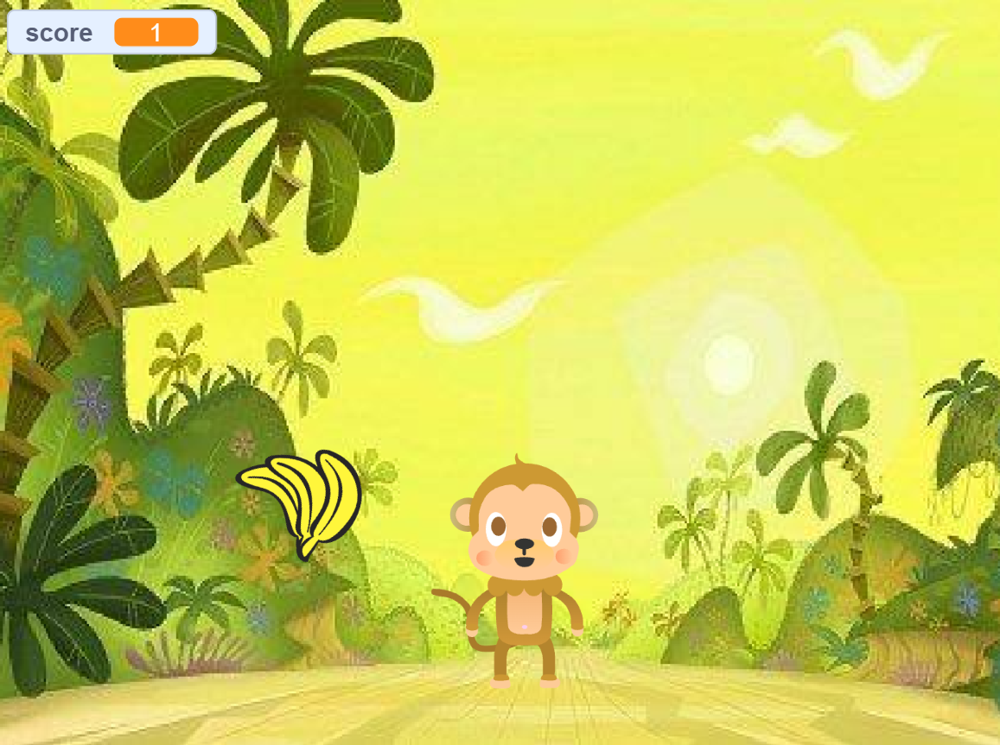
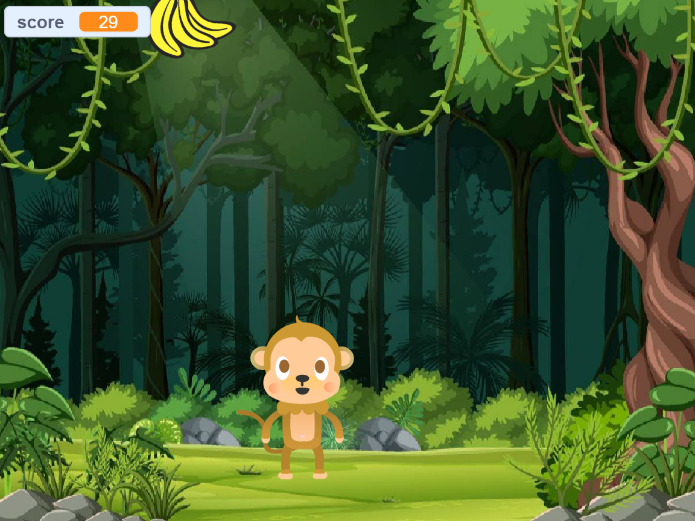
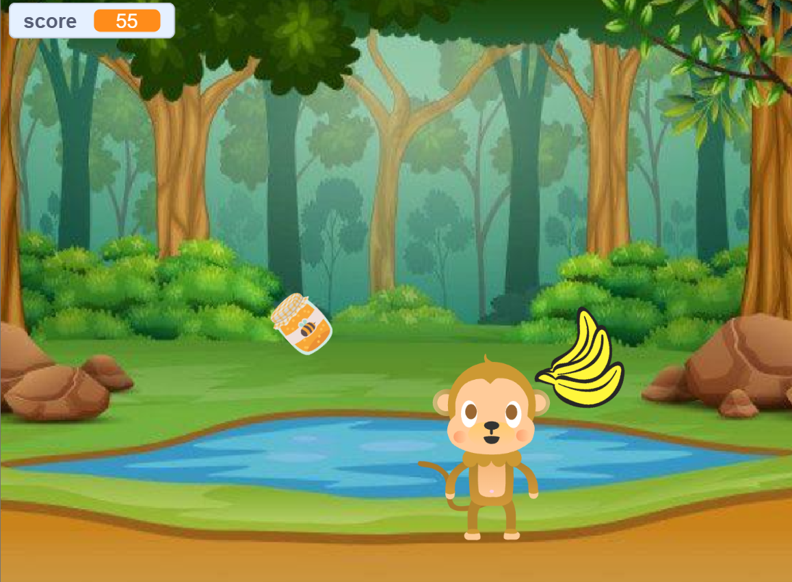

# 🐵 Monkey Banana Adventure

**A Scratch game where a monkey catches falling bananas to climb through the levels.**

---

## 🎯 Objective

Build a simple ecosystem simulation in Scratch with a game feel. A monkey lives in the jungle and eats only bananas. Each banana raises the score, and when the score reaches the set target the game moves to the next backdrop. The project shows that monkeys eat bananas to live in the forest.

**Target audience:** kids and beginner students learning about ecosystems and basic programming in Scratch.

---

## 🕹️ How the Game Works

- There are **5 characters:** Monkey, Banana, Jar, Ball and Milk.
- The monkey moves randomly left and right along the bottom of the screen.
- The banana, jar, ball and milk fall from the top.
- **Banana:** +1 score each time the monkey touches it.
- **Jar, Ball, Milk:** no score. They are non-living objects, not food.
- The banana falls faster as the score goes up.
- When a score target is reached, the game goes to the next backdrop and the score resets to 0.

### Levels

| Backdrop | Score needed to move on |
|---|---|
| `monkey2` | 25 |
| `monkey3` | 50 |
| `monkey4` | 75 |

---

## 🌿 Ecosystem Model

| Character | Role | Effect on the monkey |
|---|---|---|
| Banana | Producer (provides food and energy) | Gains energy (+1 score) |
| Monkey | Consumer (eats bananas to gain energy) | n/a |
| Jar, Ball, Milk | Non-living objects (not part of the food chain) | No energy gained (no score) |

---

## 🧠 Programming Concepts Used

- Variables (`score`, `top score`)
- If statements (is the monkey touching the banana?)
- Boolean operators
- Forever loops
- Collision detection (touching blocks)
- Motion blocks (random monkey movement)
- Random function (random positions for the monkey and falling objects)
- Backdrop switching (levels at 25, 50 and 75)
- Score reset when the backdrop changes
- Sensing blocks

---

## 🎮 Game Preview

**Start screen**

**Next levels**

### Code

**Monkey movement and level switching**

**Banana**

---

## 📄 Documentation

The full project report has the objective, flowcharts for every character, and the Scratch code:
[Scratch Project Report](Scratch_Project_Report.pdf)

---

## 💡 What I Learned

- How to create a game using Scratch
- How to use variables (score)
- How to use if conditions to check for touching objects
- How to switch backdrops when a condition is true
- Problem-solving by fixing errors in movement and scoring

## 🔮 Future Improvements

- Sound effects when the monkey eats a banana
- A timer for the game
- More levels with different backgrounds
- A "Game Over" screen

---
